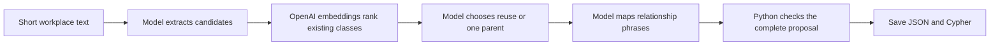

# First prototype: implementation plan

Status: implemented with Python and offline tests, plus the official Neo4j driver for database writes. Live model examples and human quality/effort measurements have not been run; the user requested no live model runs during implementation. See [README.md](README.md) for commands and current behavior.

Build a small program that reads workplace text and proposes an extension to a protected type hierarchy. Use Python dictionaries and JSON for data, the OpenAI API for generation and embeddings, and Cypher for graph output. Keep the existing arithmetic project separate.

## North star

The user's research framing guides this prototype:

> Prior research shows neuro-symbolic constraints can improve reliability; we're testing whether automatically extended foundational ontologies are accurate enough to realize those benefits with less human effort.

Treat the benefit of our automatically extended ontology as a hypothesis. This first prototype tests the beginning of that chain: can it propose useful classes, parents, and relationships while preserving the foundation, and how much human correction does it need? Passing Python checks establishes structural compliance. Human review establishes the measured quality of the proposed meanings. Neither result alone demonstrates more reliable agent behavior.

Later work can compare the same agent and tasks with no ontology constraints, the foundation alone, an automatically extended ontology, and a human-reviewed extension. Measure invalid actions and task success there. Keep that experiment outside this first implementation.

See [REPORT.md](REPORT.md) for every component's paper source and pseudocode.

## 1. Smallest useful version

- Read one short `.txt` document at a time, up to 3,000 characters. Stop with a clear message if it is longer. This is a prototype limit, not a model limit.
- Start each domain with the same seven foundation classes.
- Extract classes and relationship phrases with evidence quotes.
- Look for an existing class before adding one.
- Give each new class exactly one existing parent.
- Map phrases to the fixed predicates, or leave the relationship out.
- Validate in Python, then save JSON and parameterized Cypher.
- Reject invalid LLM decisions individually, keeping valid siblings and logging every rejection. Unreadable extractions skip only their document; service or graph-integrity failures stop the run.
- By default, clear all nodes and relationships in the selected Neo4j database at the start of each run, reload the foundation, and upload validated documents. Use `--export-only` for local files alone.
- Process documents in filename order. Accepted classes from earlier documents become available to later documents in the same domain.

Use plain functions, lists, dictionaries, loops, and clear error messages. Use Python's `json`, `math`, `pathlib`, and `re`, the official OpenAI SDK, `python-dotenv` for local credentials, and the official Neo4j driver. No agent framework, vector database, GNN, RDF, Turtle, OWL reasoner, automatic retries, web UI, or action execution.

## 2. Protected foundation

```text
Thing
  Entity
    Value
    InformationObject
    PhysicalObject
    Agent
  Action
```

Copy these parent links and write short, fixed descriptions into `foundation.json`. This foundation comes from the user's design, not from a paper. It contains **seven** classes. `Entity` and `Action` are disjoint: a class cannot descend from both.

New classes must descend from `Entity` or `Action`; they cannot attach directly to `Thing`. Never rename, delete, redefine, or reparent a foundation class. Keep the foundation file as input only and write results elsewhere.

## 3. Exact predicate contract

```python
PREDICATES = ["subClassOf", "produces", "performs", "dependsOn", "acceptsParam"]
```

| Predicate | Source type | Target type | Meaning in this prototype |
| --- | --- | --- | --- |
| subClassOf | New class | Existing class | Every member of the source type belongs to the parent type |
| produces | Action descendant | Entity descendant | Possible output type |
| performs | Agent descendant | Action descendant | Kind of action associated with this agent type |
| dependsOn | Action descendant | Entity or Action descendant | Required resource or prerequisite type |
| acceptsParam | Action descendant | Entity descendant | Allowed input type |

An ancestor includes the class itself for these checks. For example, `Agent` satisfies the Agent source rule. Multiple `acceptsParam` edges mean allowed alternatives; they do not define argument counts or required combinations.

Only `subClassOf` means universal class inclusion. The other four edges describe type-level associations or signatures. They do not record an actual person's actions, grant permission, or say that every agent performs every action. The foundation includes the user-requested `Agent performs Action` type-level association. Preserve it without requiring source-document evidence.

Use no other graph relationships. Evidence, descriptions, and review notes are JSON fields or graph properties, not extra predicates. The previous spellings `performsAction` and `acceptsAsParam`, and the old `precedes` label, are rejected in the new pipeline. Do not import the arithmetic graph.

## 4. Models

Use the OpenAI API at `https://api.openai.com/v1` with these configurable defaults:

| Job | OpenAI model | Use |
| --- | --- | --- |
| Generation | `gpt-6-luna` | Extract concepts, judge reuse, choose parents, map relationship phrases |
| Embeddings | `text-embedding-3-small` | Rank existing classes by similarity to a candidate |

The generation default is a focused-task model described in the [official model documentation](https://developers.openai.com/api/docs/models/gpt-6-luna). The [embedding guide](https://developers.openai.com/api/docs/guides/embeddings) describes the embedding endpoint. Ontology quality still needs measurement; API access is not verified by offline tests.

Use `OPENAI_API_KEY` from the environment first, then the repo root's ignored `.env.local`. Read that exact path without modifying the file or exporting its values. Keep credentials out of prompts, settings, graph files, logs, and CLI arguments. Fix the API destination so `OPENAI_BASE_URL` cannot redirect the key. Check for a key before the CLI changes local output or Neo4j. This checks presence, not server-side validity.

Use `client.responses.create` with `text={"format": {"type": "json_object"}}`, `store=False`, and `max_output_tokens=4096`, following the [JSON mode documentation](https://developers.openai.com/api/docs/guides/structured-outputs#json-mode). Existing prompts request JSON; parse `output_text` with `json.loads` and keep the same Python field checks. For the default generation model, use `reasoning={"effort": "none"}` to keep calls short. Explicit model overrides use that model's default reasoning setting. No tools, background jobs, or conversation state are needed.

Use `client.embeddings.create` with an `input` list and `encoding_format="float"`. Order vectors by their returned input index and reject missing or duplicate indexes. Embed each class's name plus description and compare vectors with cosine similarity. Store vectors in a dictionary for the current run. No similarity cutoff automatically means “same class.”

Reject malformed, refused, or incomplete generated placement or mapping replies while preserving other valid decisions. If no extraction can be read, log that document and continue to later files. Authentication, model access, rate limits, timeout, service failure, or unusable embeddings stop the run; do not silently substitute a model. Disable SDK retries. Report API errors without copying SDK error bodies or credentials into logs.

## 5. Data format

Keep the saved graph simple:

```json
{
  "classes": [
    {"name": "Thing", "description": "The root of all types.", "foundation": true},
    {"name": "Entity", "description": "A thing that is not an action.", "foundation": true}
  ],
  "relationships": [
    {"source": "Entity", "predicate": "subClassOf", "target": "Thing"}
  ]
}
```

This is a format example; the real starting graph includes all seven classes, six parent links, and `Agent performs Action`. Only Python sets the `foundation` flag. New classes and domain relationships also carry `source_file` and `evidence` fields. Source details for reused classes stay in the run's decision log so reuse does not overwrite their definitions.

Python first numbers the source sentences, for example `s1` for “Quality inspectors conduct equipment inspections.” Extraction returns candidate records with local class IDs and the ID of the supporting sentence:

```json
{
  "classes": [
    {"id": "c1", "name": "QualityInspector", "description": "An agent that inspects equipment.", "sentence_id": "s1"},
    {"id": "c2", "name": "EquipmentInspection", "description": "An action that checks equipment.", "sentence_id": "s1"}
  ],
  "relationships": [
    {"source": "c1", "phrase": "conduct", "target": "c2", "sentence_id": "s1"}
  ]
}
```

Candidate IDs must be unique. Endpoints refer to those IDs. A name must match `[A-Za-z][A-Za-z0-9_]*`. Require nonempty descriptions and a known sentence ID. Python copies the selected original sentence into each candidate's `evidence` field, then checks that the quote appears literally in the source document. This replaces model-written quotes after repeated quote-rewriting failures; it adds no model calls or automatic retries. Quotes make proposals traceable; their presence does not prove the proposal is correct.

## 6. Pipeline



1. **Load.** Start each run from the foundation. Read the next text file and check the current in-memory accepted graph before making model calls. Later documents in the same run can reuse earlier accepted additions.
2. **Extract.** Number the source sentences and pass them to one model call, which returns the candidate JSON above. Ask for types, not individuals such as “Alex” or “inspection 123.” Check records individually, rejecting invalid IDs, fields, evidence references, and endpoints. Reject all classes sharing an ambiguous local ID. Resolve valid sentence IDs to original evidence in Python, preserving the raw reply and every rejected record in the log.
3. **Match and place.** Process candidates in returned order on a private working copy. Check exact names first, but ask the model to confirm the same meaning. Rank existing extension classes using OpenAI embeddings; the foundation is always included in context, so it needs no similarity ranking. Show the model all seven foundation definitions, the top three existing extension matches, and their ancestor chains. Ask for `reuse`, `new`, or `skip`, with a short reason. Reuse requires the same meaning, not just a broader category. `new` requires a parent already in the working copy; `skip` records uncertainty. A name collision with a different meaning is skipped for review. Add a proposed class to the working copy only after its local checks pass, then embed it for later candidates.
4. **Map relationships.** Resolve candidate IDs to accepted or reused names. Log and skip relationships with unresolved endpoints. In one batch call, give the model the phrases, evidence, endpoint types, and all five predicate definitions. Return one allowed predicate or `null` for each relationship. `null` means no suitable match and is logged. Raw extraction does not directly create hierarchy edges: only the parent decision in step 3 may create `subClassOf`. Log and skip relationship-stage proposals of `subClassOf`.
5. **Validate each decision.** Check each proposed class or edge before adding it to the document's working graph. Adding a class only permits a new name under an existing parent; adding a relationship checks its endpoints, predicate, and ancestor types. Failed checks make no graph change. Keep valid siblings; skip relationships whose endpoint placements were rejected. Malformed placement replies, unknown predicates, wrong edge types, missing mappings, and duplicate mapping IDs affect only the corresponding proposals. A missing reason gets a log note rather than causing a rejection. One graph copy per document is enough; there are no full graph copies or repeated full validations for individual proposals.
6. **Save valid work.** After processing all proposals, run the complete graph checks again. Save the valid result and its decision log, including rejected proposals and summary counts. Documents with rejections use `accepted_with_rejections`. If no extraction is readable, log and skip that document and continue to later inputs. Unexpected final-graph failures and infrastructure errors stop the run without publishing that document's graph.

Ask for uncertainty explicitly in every prompt. Do not make the model invent a parent or force a phrase into the closest predicate. The seven foundation definitions always fit in context; embeddings help rank extension matches as the small graph grows.

## 7. Python checks before saving

- Required keys, correct value types, unique class names, valid identifiers, and nonempty strings.
- All seven foundation names, descriptions, flags, parent links, and `Agent performs Action` association exactly match the foundation file. No additional parent links may leave a foundation class. Reused classes keep their definitions and parents too.
- Every relationship uses the exact predicate list and has two existing endpoints.
- Every new class has exactly one parent. Reject self-parenting, cycles, disconnected classes, and classes under both `Entity` and `Action`.
- Every non-hierarchy edge obeys the source/target table using ancestor lookup.
- Every generated class and domain relationship has a source file and a literal evidence quote.
- Remove repeated copies of the same `(source, predicate, target)` edge. Keep additional evidence in the decision log.

These are structural checks for our small graph. Human review must still judge meanings, missing classes, and unsuitable parents. They are not a replacement for full formal ontology reasoning.

## 8. Cypher output

Use `OntologyClass` nodes with `(ontology, name)` as their identity. The `ontology` string keeps the manufacturing and HR experiments separate. Use a fresh prototype namespace rather than the existing arithmetic namespace.

`schema.cypher` contains fixed, parameterized statements such as:

```cypher
CREATE CONSTRAINT first_prototype_class IF NOT EXISTS
FOR (c:OntologyClass) REQUIRE (c.ontology, c.name) IS UNIQUE;

UNWIND $classes AS item
MERGE (c:OntologyClass {ontology: $ontology, name: item.name})
ON CREATE SET c.description = item.description,
              c.foundation = item.foundation,
              c.source_file = item.source_file,
              c.evidence = item.evidence;

UNWIND $performs AS edge
MATCH (a:OntologyClass {ontology: $ontology, name: edge.source})
MATCH (b:OntologyClass {ontology: $ontology, name: edge.target})
MERGE (a)-[r:performs]->(b)
ON CREATE SET r.source_file = edge.source_file, r.evidence = edge.evidence;
```

The exporter also writes statements for `subClassOf`, `produces`, `dependsOn`, and `acceptsParam`. It exports the corresponding edge lists, class list, and namespace in `params.json`, with `null` source fields for the original foundation. The model never writes Cypher; generated names and evidence never enter query text. Labels come only from the fixed predicate list; values are parameters.

At the user's request, Neo4j upload is now part of the prototype. `neo4j_client.py` uses the official driver and these same parameterized queries. At the start of a connected run, one data transaction executes `MATCH (n) DETACH DELETE n` and reloads the foundation. This clears the entire selected database, not just the current ontology namespace. The uniqueness constraint is created separately; existing constraints and indexes are retained. Each accepted document then adds its cumulative graph in another transaction without clearing again. A failed database data transaction is rolled back. Use `--export-only` to skip database access. There is no saved-state loading between runs.

## 9. Build order and implementation files

| Order | Work | Done when |
| --- | --- | --- |
| 1 | Write `foundation.json`, predicate rules, and simple graph functions | A hand-written valid extension passes; a forbidden predicate fails |
| 2 | Write OpenAI helpers for JSON generation and embeddings | Mocked API responses pass; credentials stay out of output |
| 3 | Write extraction, matching/placement, and phrase mapping | One manufacturing example reaches validation |
| 4 | Add logs, JSON saving, and Cypher export | Only validated proposals appear in export |
| 5 | Run manufacturing and HR examples separately; review results | Structural checks pass and human corrections are recorded |

Source files:

```text
first prototype/
  PLAN.md                This implementation plan
  REPORT.md              Component sources and pseudocode
  README.md              Running and reviewing the program
  foundation.json        Seven protected classes, parent links, and Agent performs Action
  prototype.py           Read files and run the pipeline in order
  openai_client.py        Runtime credentials, JSON generation, and embeddings
  prompts.py              Plain instructions for the three model jobs
  graph.py               Predicate rules, ancestor checks, validation, export
  neo4j_client.py         Connect, reset at run start, and write accepted graphs
  requirements.txt       OpenAI SDK, python-dotenv, and Neo4j driver
  test_graph.py          Focused validation and export checks
  test_neo4j.py          Offline database integration checks
  test_openai.py         Offline API and credential checks
  review_template.json   Blank human quality and effort measurements
  examples/
    manufacturing.txt
    manufacturing_02.txt
    hr.txt
    arithmetic.txt       Numeric types, arithmetic actions, inputs, and outputs
    REVIEW.md            Expected shapes for a human to review
  output/
    manufacturing/       graph.json, decisions.json, schema.cypher, params.json
    hr/                  Separate graph with the same foundation
```

The files above are implemented. Each run starts from the foundation, initializes local output, and processes all supplied documents in filename order. A connected run first clears the selected database and reloads the foundation. Valid decisions update Neo4j and the four generated output files. Individual rejections go in `decisions.json`; unreadable document extractions and run-stopping errors go in `failures/`. Output files from previous runs are never loaded into the pipeline. Human measurements and corrected graphs remain separate from generated output. Keep most functions short, give variables everyday names, and comment on why a rule exists. Prefer an ordinary loop over a clever one-line expression. Add helpers only when they make the program easier to follow.

The code remains ordinary Python. `process_document(text, log=...)` can be called directly and returns an in-memory graph using the default foundation and models. File output and Neo4j writes remain explicit steps in `run`. This makes a later notebook demonstration possible without converting the source now. Candidate checks run directly once per record; audit logs avoid duplicate candidate lists and graph snapshots. Raw model calls, decisions, rejection reasons, summary counts, and timing remain available.

## 10. Small acceptance exercise

Manufacturing input:

> Quality inspectors conduct equipment inspections. Equipment inspections produce inspection reports, require equipment, and accept inspection checklists as inputs.

Expected human-reviewed shape:

```text
QualityInspector subClassOf Agent
EquipmentInspection subClassOf Action
InspectionReport subClassOf InformationObject
Equipment subClassOf PhysicalObject
InspectionChecklist subClassOf InformationObject
QualityInspector performs EquipmentInspection
EquipmentInspection produces InspectionReport
EquipmentInspection dependsOn Equipment
EquipmentInspection acceptsParam InspectionChecklist
```

HR input:

> Recruiters conduct candidate screenings. Candidate screenings produce screening reports, require job descriptions, and accept candidate applications as inputs.

Review analogous placements under `Agent`, `Action`, and `InformationObject`. Use the same foundation and predicate rules for both domains. Exact generated names may differ; a person must judge whether the meaning matches.

Add a second manufacturing document that repeats “equipment inspection” to check reuse. Prepare a tiny human reference before inspecting model output. Record expected classes recovered, parent mistakes, predicate mistakes, skipped items, duplicates, and number of manual corrections. Ask two simple questions per domain, such as “Which agent type performs this action?” and “Which report type can it produce?” Check whether the output graph can answer them. This adapts the question-driven evaluation idea in [OntoExtend, Section 4](https://arxiv.org/html/2607.17963v1).

Also time the human work: minutes spent making the small reference and minutes spent reviewing and correcting the generated graph. Record creation, deletion, reparenting, and relationship corrections separately. These small-sample times are exploratory; they do not establish a general labor-saving result. Keep model runtime separate from human effort. Save the raw proposals and corrected results so a low error count cannot hide heavy editing or many skipped concepts.

Focused Python tests should cover unknown predicates, bad endpoints, changed foundation definitions or parents, cycles, disjointness, wrong edge types, bad evidence, subtype-versus-equivalence reuse, and preserving valid work alongside invalid decisions. Cover echoed placement replies, unreadable document extractions, duplicate IDs, and service failures separately. Include a valid case using all five predicates and check that Cypher parameters preserve quotes and newlines as data. Model quality needs a local run and human review; mocked responses only test pipeline behavior.
